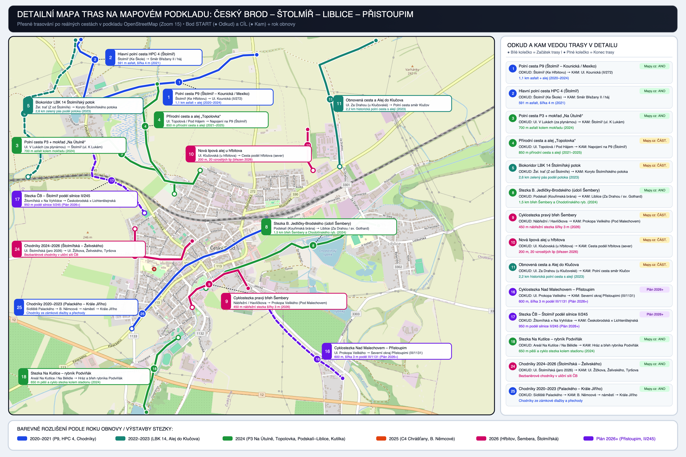
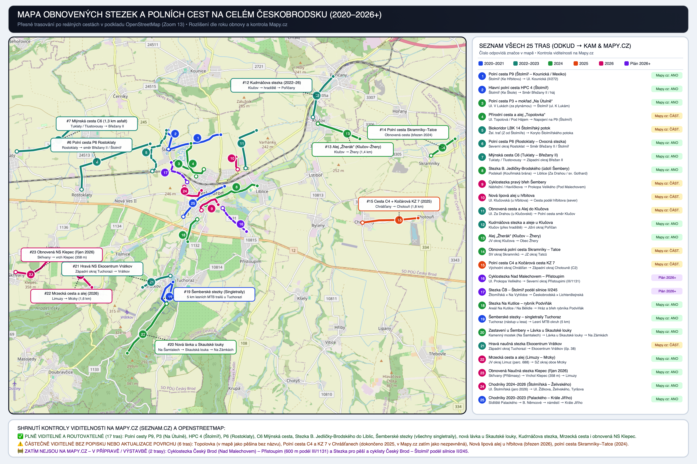
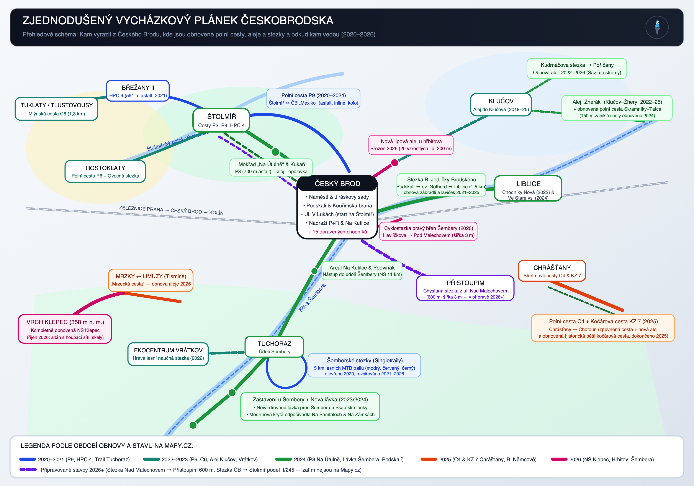
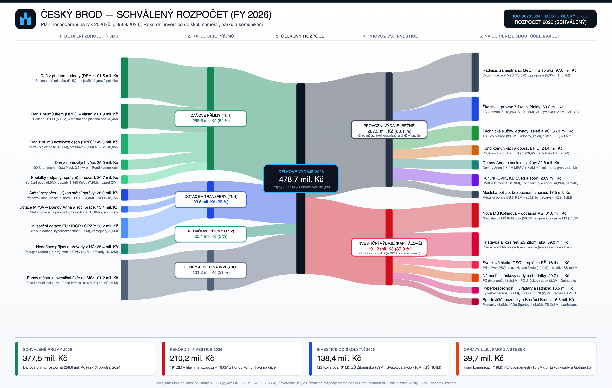
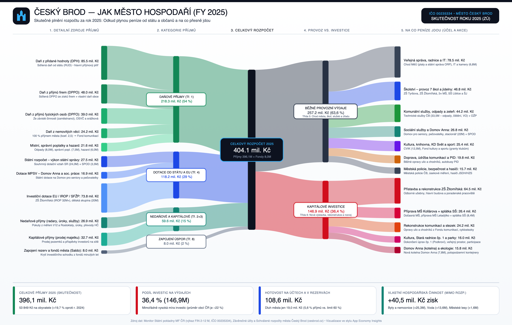
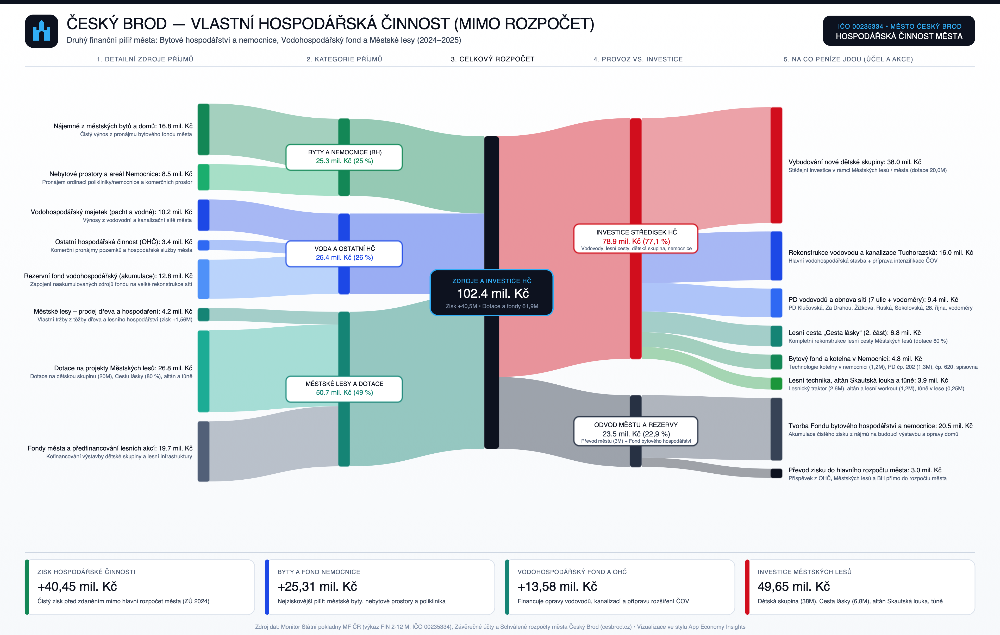

# Český Brod & Českobrodsko: Mapa obnovených stezek (2020–2026+) a Rozpočet města ve stylu App Economy Insights

Tento dokument spojuje oba požadované výstupy postavené na reálných veřejných datech města **Český Brod (`IČO 00235334`)**, **Státního pozemkového úřadu (SPÚ – KPÚ)**, **Registru smluv**, **profilu zadavatele E-ZAK** a **Monitoru Státní pokladny MF ČR**:

1. **Cíl 1 — Mapy Českobrodska a obnovených cest/stezek (2020–2026+):**
   - **Zjednodušený vycházkový plánek** (*„Kam vyrazit z Českého Brodu a odkud kam vedou nové cesty“*).
   - **Podrobná kartografická mapa podle roku obnovy** s kontrolou viditelnosti na **Mapy.cz (Seznam.cz)** a přímými prokliky do turistické mapy.
2. **Cíl 2 — Rozpočet města Český Brod ve stylu „App Economy Insights“ (Sankey diagramy):**
   - Toky peněz od jednotlivých daní (DPH, DPPO, DPFO, daň z nemovitostí, poplatky) a státních/evropských dotací až po provozní výdaje a jmenovité investiční akce za **skutečnost roku 2025 (`404,1 mil. Kč`)** a **schválený rozpočet 2026 (`478,7 mil. Kč`)**.

> [!TIP]
> Kromě statických infografik níže si můžete otevřít i **interaktivní aplikaci** [index.html](./index.html), kde lze trasy filtrovat podle roku, typu i stavu na Mapy.cz a interaktivně přepínat Sankey diagramy rozpočtu mezi lety **2023, 2024, 2025 a 2026**.

> **🗺️ Interaktivní mapa přímo v GitHubu:** Klikněte na soubor [`trasy_ceskobrodsko.geojson`](./trasy_ceskobrodsko.geojson) — GitHub v prohlížeči nativně vykreslí všech 25 tras na interaktivní mapě OpenStreetMap.
> **🌐 Webová aplikace (GitHub Pages):** Soubor [`index.html`](./index.html) obsahuje kompletní interaktivní aplikaci (mapa stezek + přepínací Sankey diagramy rozpočtu 2023–2026 a VHČ).

---

## CÍL 1: Mapy Českobrodska s reálným mapovým podkladem, vyznačením ODKUD → KAM, rokem obnovy a kontrolou Mapy.cz

### Kam vyrazit: 6 hlavních vycházkových a cyklistických směrů

1. **Severozápadní okruh na Štolmíř (kočárky, inline brusle, kolo, běh, pěší):**
   - Z ulice **V Lukách** vyrazíte kolem **mokřadu a ptačí pozorovatelny Kukaň („Na Útulně“)** po hladké 700m asfaltové **polní cestě P3 (`#3`)** do Štolmíře.
   - Zpět se můžete vrátit buď souběžnou přírodní alejí **Topolovka (`#4`)**, nebo udělat velký asfaltový okruh ze severního okraje Štolmíře po **polní cestě P9 (`#1`)** přes pole zpět do čtvrti „Mexiko“ (ul. Kounická / V Lukách).
   - Ze Štolmíře pokračuje nová asfaltová cesta **HPC 4 (`#2`, 591 m)** směrem na Břežany II a navazuje na **Mlýnskou cestu C6 (`#7`, 1,3 km asfalt)** do Tuklat/Tlustovous a na **polní cestu P6 (`#6`)** do Rostoklat.
2. **Východní směr údolím Šembery do Liblic:**
   - Od **Kouřimské brány a Podskalí** (kde bylo doplněno nové akátové zábradlí a lavičky) vede podél levého břehu říčky Šembery kolem barokní **kapličky sv. Gotharda** a Chodotínského rybníka **Stezka Břetislava Jedličky-Brodského (`#8`, 1,5 km)** až do Liblic k ulici Za Drahou.
   - Souběžně na pravém břehu Šembery mezi Havlíčkovou ulicí (u bývalých stavebnin PRO-DOMA) a novou čtvrtí **Pod Malechovem** vzniká v letech 2025–2026 nová třímetrová **nábřežní cyklostezka a promenáda (`#9`)**.
3. **Severovýchodní směr — Nová lipová alej u hřbitova a Alej do Klučova:**
   - U městského hřbitova (mezi ul. Klučovská a Kounická) byla v **březnu 2026** vysazena **nová lipová alej (`#10`, 20 vzrostlých lip, 200 m)**.
   - Za železniční tratí od Klučovské ulice pokračuje obnovená historická polní cesta a **Alej do Klučova (`#11`)**, na kterou navazuje **Kudrnáčova stezka (`#12`)** do Poříčan, **Alej „Žherák“ (`#13`)** z Klučova do Žher a v březnu 2024 obnovená dříve zaoraná polní cesta **Skramníky – Tatce (`#14`, 150 m)**.
4. **Jihovýchodní směr — Přistoupim a nová kočárová/polní cesta v Chrášťanech:**
   - Z ulice **Nad Malechovem** do **Přistoupimi** připravuje město společně s obcí 600 m dlouhou a 3 m širokou **cyklostezku (`#16`)** oddělenou od silnice III/1131 zeleným pásem.
   - Jižně od **Chrášťan** směrem na Chotouň byla v **polovině roku 2025** dokončena nová zpevněná **polní cesta C4 a souběžná ozeleněná historická kočárová cesta KZ 7 (`#15`)**.
5. **Jižní směr — Kutilka, Údolí Šembery, Šemberské stezky (MTB), nová lávka u Skautské louky a Vrátkov:**
   - Od sportovního areálu **Na Kutilce (`#18`)** a rybníka **Podviňák** vede 11 km dlouhá **Naučná stezka Údolím Šembery** přes Zahrady a Tuchoraz.
   - V lese za Tuchorazí najdete **Šemberské stezky (`#19`)** — 5 km jednosměrných přírodních singletrailů pro horská kola (stoupací + modrý, červený a černý trail).
   - Dál v údolí Šembery byla v letech **2023/2024** vybudována **nová dřevěná lávka přes Šemberu u Skautské louky (`#20`)** a **3 krytá modřínová odpočívadla** (*Na Šamtalech* u Kamenného mostku, *Na Zámkách* u soutoku s Lázným potokem a ve *Štolmířském háji*), v roce 2025 doplněná o rekonstrukci lesní **Cesty lásky** a altán s lesním workoutem.
   - Z Tuchorazi vede mimo silnici také **Hravá naučná stezka do Ekocentra Vrátkov (`#21`)**.
6. **Jihozápadní směr — Mrzecká cesta a kompletně obnovená Naučná stezka Klepec (říjen 2026):**
   - Mezi **Mrzky a Limuzy (`#22`)** vede po polní cestě ovocná alej s naučnými prvky (na podzim 2026 připravena k celkové obnově stromořadí).
   - U **Skřivan / Přišimas (`#23`)** byla v **říjnu 2026** po kompletní rekonstrukci slavnostně otevřena **Naučná stezka Klepec** přes vrchol Klepec (358 m n. m.) k žulovým skalám *Slouha* a *Stoh slámy* — nově vybavená krytým posezením s houpací sítí, lavičkami a novými infopanely.

---

### Kompletní přehled všech 25 zmapovaných tras (přesná stopa podle reálných cest v mapě + aktivní vykreslení trasy A→B)

> [!IMPORTANT]
> **Jak fungují aktivní prokliky v tabulce níže:**
> - **🗺️ Trasa A→B (Google Maps)** — po kliknutí **aktivně vykreslí celou pěší trasu v mapě** od výchozího bodu **A (START)** přes průjezdní body (`waypoints`) až do koncového bodu **B (CÍL)**.
> - **🟢 Start A (Mapy.cz)** a **🏁 Cíl B (Mapy.cz)** — pomocí parametru `source=coor&id=...` **aktivně zapíchnou červený špendlík** v turistické mapě Mapy.cz přesně na začátek nebo konec dané cesty.

| # | Název cesty / stezky | Rok obnovy | 🟢 START (A) → 🏁 CÍL (B) | Délka a povrch | Viditelnost na Mapy.cz | Aktivní prokliky (vykreslení trasy A→B a špendlíky) |
| :-: | :--- | :---: | :--- | :--- | :---: | :--- |
| **1** | **Polní cesta P9 (Štolmíř – Kounická / Mexiko)** | **2020–2021** | **A:** Štolmíř (Ke Hřbitovu) (`50.0865N, 14.8419E`) → **B:** Ul. Kounická (II/272) (`50.0907N, 14.8652E`) | 1,1 km asfalt + alej (2020–2024) | ✅ **ANO** | [🗺️ **Trasa A→B (Google Maps)**](https://www.google.com/maps/dir/?api=1&origin=50.08650,14.84193&destination=50.09074,14.86523&waypoints=50.08796,14.84935%7C50.08942,14.86008&travelmode=walking) • [🟢 Start A (Mapy.cz)](https://mapy.cz/turisticka?source=coor&id=14.84193%2C50.08650&x=14.84193&y=50.08650&z=16) • [🏁 Cíl B (Mapy.cz)](https://mapy.cz/turisticka?source=coor&id=14.86523%2C50.09074&x=14.86523&y=50.09074&z=16) |
| **2** | **Hlavní polní cesta HPC 4 (Štolmíř)** | **2020–2021** | **A:** Štolmíř (Ke Škole) (`50.0866N, 14.8417E`) → **B:** Směr Břežany II / háj (`50.0921N, 14.8415E`) | 591 m asfalt, šířka 4 m (2021) | ✅ **ANO** | [🗺️ **Trasa A→B (Google Maps)**](https://www.google.com/maps/dir/?api=1&origin=50.08656,14.84167&destination=50.09206,14.84150&waypoints=50.08887,14.84262%7C50.09102,14.84141&travelmode=walking) • [🟢 Start A (Mapy.cz)](https://mapy.cz/turisticka?source=coor&id=14.84167%2C50.08656&x=14.84167&y=50.08656&z=16) • [🏁 Cíl B (Mapy.cz)](https://mapy.cz/turisticka?source=coor&id=14.84150%2C50.09206&x=14.84150&y=50.09206&z=16) |
| **3** | **Polní cesta P3 + mokřad „Na Útulně“** | **2024** | **A:** Ul. V Lukách (za plynárnou) (`50.0787N, 14.8541E`) → **B:** Štolmíř (ul. K Lukám) (`50.0828N, 14.8430E`) | 700 m asfalt kolem mokřadu (2024) | ✅ **ANO** | [🗺️ **Trasa A→B (Google Maps)**](https://www.google.com/maps/dir/?api=1&origin=50.07868,14.85412&destination=50.08281,14.84296&waypoints=50.08088,14.85073%7C50.08298,14.84588&travelmode=walking) • [🟢 Start A (Mapy.cz)](https://mapy.cz/turisticka?source=coor&id=14.85412%2C50.07868&x=14.85412&y=50.07868&z=16) • [🏁 Cíl B (Mapy.cz)](https://mapy.cz/turisticka?source=coor&id=14.84296%2C50.08281&x=14.84296&y=50.08281&z=16) |
| **4** | **Přírodní cesta a alej „Topolovka“** | **2024** | **A:** Ul. Topolová / Pod Hájem (`50.0807N, 14.8576E`) → **B:** Napojení na P9 (Štolmíř) (`50.0882N, 14.8518E`) | 850 m přírodní cesta s alejí (2021–2025) | ⚠️ **ČÁSTEČNĚ** | [🗺️ **Trasa A→B (Google Maps)**](https://www.google.com/maps/dir/?api=1&origin=50.08072,14.85759&destination=50.08821,14.85180&waypoints=50.08044,14.85223%7C50.08601,14.84987&travelmode=walking) • [🟢 Start A (Mapy.cz)](https://mapy.cz/turisticka?source=coor&id=14.85759%2C50.08072&x=14.85759&y=50.08072&z=16) • [🏁 Cíl B (Mapy.cz)](https://mapy.cz/turisticka?source=coor&id=14.85180%2C50.08821&x=14.85180&y=50.08821&z=16) |
| **5** | **Biokoridor LBK 14 Štolmířský potok** | **2022–2023** | **A:** Žel. trať (Z od Štolmíře) (`50.0802N, 14.8344E`) → **B:** Koryto Štolmířského potoka (`50.0920N, 14.8408E`) | 2,6 km zelený pás podél potoka (2023) | ⚠️ **ČÁSTEČNĚ** | [🗺️ **Trasa A→B (Google Maps)**](https://www.google.com/maps/dir/?api=1&origin=50.08017,14.83438&destination=50.09201,14.84077&waypoints=50.08331,14.83506%7C50.08755,14.83777&travelmode=walking) • [🟢 Start A (Mapy.cz)](https://mapy.cz/turisticka?source=coor&id=14.83438%2C50.08017&x=14.83438&y=50.08017&z=16) • [🏁 Cíl B (Mapy.cz)](https://mapy.cz/turisticka?source=coor&id=14.84077%2C50.09201&x=14.84077&y=50.09201&z=16) |
| **6** | **Polní cesta P6 (Rostoklaty – Ovocná stezka)** | **2022–2023** | **A:** Severní okraj Rostoklat (`50.0749N, 14.8025E`) → **B:** Směr Břežany II / Štolmíř (`50.0881N, 14.8334E`) | 1,2 km zpevněná cesta + alej (2022) | ✅ **ANO** | [🗺️ **Trasa A→B (Google Maps)**](https://www.google.com/maps/dir/?api=1&origin=50.07488,14.80253&destination=50.08810,14.83343&waypoints=50.08149,14.80202%7C50.08468,14.81712&travelmode=walking) • [🟢 Start A (Mapy.cz)](https://mapy.cz/turisticka?source=coor&id=14.80253%2C50.07488&x=14.80253&y=50.07488&z=16) • [🏁 Cíl B (Mapy.cz)](https://mapy.cz/turisticka?source=coor&id=14.83343%2C50.08810&x=14.83343&y=50.08810&z=16) |
| **7** | **Mlýnská cesta C6 (Tuklaty – Břežany II)** | **2022–2023** | **A:** Tuklaty / Tlustovousy (`50.0859N, 14.7734E`) → **B:** Západní okraj Břežan II (`50.0936N, 14.8008E`) | 1,3 km asfalt + stromořadí (2022) | ✅ **ANO** | [🗺️ **Trasa A→B (Google Maps)**](https://www.google.com/maps/dir/?api=1&origin=50.08590,14.77335&destination=50.09360,14.80082&waypoints=50.08700,14.78708%7C50.09195,14.79687&travelmode=walking) • [🟢 Start A (Mapy.cz)](https://mapy.cz/turisticka?source=coor&id=14.77335%2C50.08590&x=14.77335&y=50.08590&z=16) • [🏁 Cíl B (Mapy.cz)](https://mapy.cz/turisticka?source=coor&id=14.80082%2C50.09360&x=14.80082&y=50.09360&z=16) |
| **8** | **Stezka B. Jedličky-Brodského (údolí Šembery)** | **2024** | **A:** Podskalí (Kouřimská brána) (`50.0705N, 14.8584E`) → **B:** Liblice (Za Drahou / sv. Gothard) (`50.0759N, 14.8817E`) | 1,5 km břeh Šembery a Chodotínského ryb. (2024) | ✅ **ANO** | [🗺️ **Trasa A→B (Google Maps)**](https://www.google.com/maps/dir/?api=1&origin=50.07050,14.85837&destination=50.07593,14.88167&waypoints=50.07317,14.86652%7C50.07449,14.87472&travelmode=walking) • [🟢 Start A (Mapy.cz)](https://mapy.cz/turisticka?source=coor&id=14.85837%2C50.07050&x=14.85837&y=50.07050&z=16) • [🏁 Cíl B (Mapy.cz)](https://mapy.cz/turisticka?source=coor&id=14.88167%2C50.07593&x=14.88167&y=50.07593&z=16) |
| **9** | **Cyklostezka pravý břeh Šembery** | **2026** | **A:** Nábřežní / Havlíčkova (`50.0688N, 14.8565E`) → **B:** Prokopa Velikého (Pod Malechovem) (`50.0705N, 14.8641E`) | 450 m nábřežní stezka šířky 3 m (2026) | ⚠️ **ČÁSTEČNĚ** | [🗺️ **Trasa A→B (Google Maps)**](https://www.google.com/maps/dir/?api=1&origin=50.06885,14.85652&destination=50.07050,14.86407&waypoints=50.07042,14.85712%7C50.07174,14.86081&travelmode=walking) • [🟢 Start A (Mapy.cz)](https://mapy.cz/turisticka?source=coor&id=14.85652%2C50.06885&x=14.85652&y=50.06885&z=16) • [🏁 Cíl B (Mapy.cz)](https://mapy.cz/turisticka?source=coor&id=14.86407%2C50.07050&x=14.86407&y=50.07050&z=16) |
| **10** | **Nová lipová alej u hřbitova** | **2026** | **A:** Ul. Klučovská (u hřbitova) (`50.0807N, 14.8728E`) → **B:** Cesta podél hřbitova (sever) (`50.0843N, 14.8721E`) | 200 m, 20 vzrostlých lip (březen 2026) | ⚠️ **ČÁSTEČNĚ** | [🗺️ **Trasa A→B (Google Maps)**](https://www.google.com/maps/dir/?api=1&origin=50.08072,14.87283&destination=50.08427,14.87210&waypoints=50.08289,14.87210&travelmode=walking) • [🟢 Start A (Mapy.cz)](https://mapy.cz/turisticka?source=coor&id=14.87283%2C50.08072&x=14.87283&y=50.08072&z=16) • [🏁 Cíl B (Mapy.cz)](https://mapy.cz/turisticka?source=coor&id=14.87210%2C50.08427&x=14.87210&y=50.08427&z=16) |
| **11** | **Obnovená cesta a Alej do Klučova** | **2022–2023** | **A:** Ul. Za Drahou (u Klučovské) (`50.0810N, 14.8764E`) → **B:** Polní cesta směr Klučov (`50.0920N, 14.8813E`) | 2,2 km historická polní cesta s alejí (2023) | ⚠️ **ČÁSTEČNĚ** | [🗺️ **Trasa A→B (Google Maps)**](https://www.google.com/maps/dir/?api=1&origin=50.08105,14.87643&destination=50.09198,14.88132&waypoints=50.08551,14.87557%7C50.08986,14.87369&travelmode=walking) • [🟢 Start A (Mapy.cz)](https://mapy.cz/turisticka?source=coor&id=14.87643%2C50.08105&x=14.87643&y=50.08105&z=16) • [🏁 Cíl B (Mapy.cz)](https://mapy.cz/turisticka?source=coor&id=14.88132%2C50.09198&x=14.88132&y=50.09198&z=16) |
| **12** | **Kudrnáčova stezka a aleje u Klučova** | **2022–2023** | **A:** Klučov (přes hradiště) (`50.0958N, 14.9067E`) → **B:** Jižní okraj Poříčan (`50.1076N, 14.9158E`) | 2,5 km historická stezka + stromořadí | ✅ **ANO** | [🗺️ **Trasa A→B (Google Maps)**](https://www.google.com/maps/dir/?api=1&origin=50.09581,14.90673&destination=50.10759,14.91583&waypoints=50.09911,14.90776%7C50.10495,14.91188&travelmode=walking) • [🟢 Start A (Mapy.cz)](https://mapy.cz/turisticka?source=coor&id=14.90673%2C50.09581&x=14.90673&y=50.09581&z=16) • [🏁 Cíl B (Mapy.cz)](https://mapy.cz/turisticka?source=coor&id=14.91583%2C50.10759&x=14.91583&y=50.10759&z=16) |
| **13** | **Alej „Žherák“ (Klučov – Žhery)** | **2024** | **A:** JV okraj Klučova (`50.0939N, 14.9090E`) → **B:** Obec Žhery (`50.0895N, 14.9278E`) | 1,4 km cesta + 34 stromů (2024) | ✅ **ANO** | [🗺️ **Trasa A→B (Google Maps)**](https://www.google.com/maps/dir/?api=1&origin=50.09394,14.90896&destination=50.08953,14.92785&waypoints=50.09107,14.92218&travelmode=walking) • [🟢 Start A (Mapy.cz)](https://mapy.cz/turisticka?source=coor&id=14.90896%2C50.09394&x=14.90896&y=50.09394&z=16) • [🏁 Cíl B (Mapy.cz)](https://mapy.cz/turisticka?source=coor&id=14.92785%2C50.08953&x=14.92785&y=50.08953&z=16) |
| **14** | **Obnovená polní cesta Skramníky – Tatce** | **2024** | **A:** SV okraj Skramníků (`50.0847N, 14.9599E`) → **B:** JZ okraj Tatců (`50.0895N, 14.9708E`) | 150 m obnovené polní cesty (2024) | ⚠️ **ČÁSTEČNĚ** | [🗺️ **Trasa A→B (Google Maps)**](https://www.google.com/maps/dir/?api=1&origin=50.08468,14.95995&destination=50.08953,14.97076&waypoints=50.08700,14.96510&travelmode=walking) • [🟢 Start A (Mapy.cz)](https://mapy.cz/turisticka?source=coor&id=14.95995%2C50.08468&x=14.95995&y=50.08468&z=16) • [🏁 Cíl B (Mapy.cz)](https://mapy.cz/turisticka?source=coor&id=14.97076%2C50.08953&x=14.97076&y=50.08953&z=16) |
| **15** | **Polní cesta C4 a Kočárová cesta KZ 7** | **2025** | **A:** Východní okraj Chrášťan (`50.0653N, 14.9291E`) → **B:** Západní okraj Chotouně (C2) (`50.0666N, 14.9541E`) | 1,8 km zpevněná cesta + alej (2025) | ⚠️ **ČÁSTEČNĚ** | [🗺️ **Trasa A→B (Google Maps)**](https://www.google.com/maps/dir/?api=1&origin=50.06529,14.92905&destination=50.06662,14.95411&waypoints=50.06607,14.94553&travelmode=walking) • [🟢 Start A (Mapy.cz)](https://mapy.cz/turisticka?source=coor&id=14.92905%2C50.06529&x=14.92905&y=50.06529&z=16) • [🏁 Cíl B (Mapy.cz)](https://mapy.cz/turisticka?source=coor&id=14.95411%2C50.06662&x=14.95411&y=50.06662&z=16) |
| **16** | **Cyklostezka Nad Malechovem – Přistoupim** | **Plán 2026+** | **A:** Ul. Prokopa Velikého (`50.0695N, 14.8661E`) → **B:** Severní okraj Přistoupimi (III/1131) (`50.0627N, 14.8768E`) | 600 m, šířka 3 m podél III/1131 (Plán 2026+) | 🚧 **NE (Plán)** | [🗺️ **Trasa A→B (Google Maps)**](https://www.google.com/maps/dir/?api=1&origin=50.06948,14.86609&destination=50.06270,14.87682&waypoints=50.06656,14.86952%7C50.06436,14.87339&travelmode=walking) • [🟢 Start A (Mapy.cz)](https://mapy.cz/turisticka?source=coor&id=14.86609%2C50.06948&x=14.86609&y=50.06948&z=16) • [🏁 Cíl B (Mapy.cz)](https://mapy.cz/turisticka?source=coor&id=14.87682%2C50.06270&x=14.87682&y=50.06270&z=16) |
| **17** | **Stezka ČB – Štolmíř podél silnice II/245** | **Plán 2026+** | **A:** Žitomířská × Na Vyhlídce (`50.0770N, 14.8501E`) → **B:** Českobrodská × Lichtenštejnská (`50.0827N, 14.8429E`) | 950 m podél silnice II/245 (Plán 2026+) | 🚧 **NE (Plán)** | [🗺️ **Trasa A→B (Google Maps)**](https://www.google.com/maps/dir/?api=1&origin=50.07703,14.85008&destination=50.08270,14.84292&waypoints=50.07929,14.84734%7C50.08061,14.84296&travelmode=walking) • [🟢 Start A (Mapy.cz)](https://mapy.cz/turisticka?source=coor&id=14.85008%2C50.07703&x=14.85008&y=50.07703&z=16) • [🏁 Cíl B (Mapy.cz)](https://mapy.cz/turisticka?source=coor&id=14.84292%2C50.08270&x=14.84292&y=50.08270&z=16) |
| **18** | **Stezka Na Kutilce – rybník Podviňák** | **2024** | **A:** Areál Na Kutilce / Na Bělidle (`50.0662N, 14.8546E`) → **B:** Hráz a břeh rybníka Podviňák (`50.0598N, 14.8503E`) | 650 m pěší a cyklo stezka kolem stadionu (2024) | ✅ **ANO** | [🗺️ **Trasa A→B (Google Maps)**](https://www.google.com/maps/dir/?api=1&origin=50.06623,14.85463&destination=50.05976,14.85034&waypoints=50.06472,14.85180%7C50.06155,14.85051&travelmode=walking) • [🟢 Start A (Mapy.cz)](https://mapy.cz/turisticka?source=coor&id=14.85463%2C50.06623&x=14.85463&y=50.06623&z=16) • [🏁 Cíl B (Mapy.cz)](https://mapy.cz/turisticka?source=coor&id=14.85034%2C50.05976&x=14.85034&y=50.05976&z=16) |
| **19** | **Šemberské stezky – singletraily Tuchoraz** | **2020–2021** | **A:** Tuchoraz (nástup u lesa) (`50.0481N, 14.8437E`) → **B:** Lesní MTB okruh (5 km) (`50.0481N, 14.8437E`) | 5 km MTB trailů v lese (modrý, červený, černý) | ✅ **ANO** | [🗺️ **Trasa A→B (Google Maps)**](https://www.google.com/maps/dir/?api=1&origin=50.04810,14.84373&destination=50.04810,14.84373&waypoints=50.04182,14.84081%7C50.04623,14.84030&travelmode=walking) • [🟢 Start A (Mapy.cz)](https://mapy.cz/turisticka?source=coor&id=14.84373%2C50.04810&x=14.84373&y=50.04810&z=16) • [🏁 Cíl B (Mapy.cz)](https://mapy.cz/turisticka?source=coor&id=14.84373%2C50.04810&x=14.84373&y=50.04810&z=16) |
| **20** | **Zastavení u Šembery + Lávka u Skautské louky** | **2024** | **A:** Kamenný mostek (Na Šamtalech) (`50.0418N, 14.8408E`) → **B:** Lávka u Skautské louky → Na Zámkách (`50.0275N, 14.8231E`) | 3,5 km údolím Šembery, nová lávka a 3 altány | ✅ **ANO** | [🗺️ **Trasa A→B (Google Maps)**](https://www.google.com/maps/dir/?api=1&origin=50.04182,14.84081&destination=50.02748,14.82313&waypoints=50.03553,14.83395%7C50.03046,14.82605&travelmode=walking) • [🟢 Start A (Mapy.cz)](https://mapy.cz/turisticka?source=coor&id=14.84081%2C50.04182&x=14.84081&y=50.04182&z=16) • [🏁 Cíl B (Mapy.cz)](https://mapy.cz/turisticka?source=coor&id=14.82313%2C50.02748&x=14.82313&y=50.02748&z=16) |
| **21** | **Hravá naučná stezka Ekocentrum Vrátkov** | **2022–2023** | **A:** Západní okraj Tuchorazi (`50.0499N, 14.8425E`) → **B:** Ekocentrum Vrátkov (čp. 38) (`50.0466N, 14.8300E`) | 1,2 km stezka s herními prvky mimo hlavní tah | ⚠️ **ČÁSTEČNĚ** | [🗺️ **Trasa A→B (Google Maps)**](https://www.google.com/maps/dir/?api=1&origin=50.04986,14.84253&destination=50.04656,14.83000&waypoints=50.04810,14.83395&travelmode=walking) • [🟢 Start A (Mapy.cz)](https://mapy.cz/turisticka?source=coor&id=14.84253%2C50.04986&x=14.84253&y=50.04986&z=16) • [🏁 Cíl B (Mapy.cz)](https://mapy.cz/turisticka?source=coor&id=14.83000%2C50.04656&x=14.83000&y=50.04656&z=16) |
| **22** | **Mrzecká cesta a alej (Limuzy – Mrzky)** | **2026** | **A:** JV okraj Limuz (parc. 688) (`50.0569N, 14.7922E`) → **B:** SZ okraj obce Mrzky (`50.0466N, 14.8072E`) | 1,6 km polní cesta s alejí (obnova 2026) | ✅ **ANO** | [🗺️ **Trasa A→B (Google Maps)**](https://www.google.com/maps/dir/?api=1&origin=50.05692,14.79223&destination=50.04656,14.80717&waypoints=50.05008,14.80202&travelmode=walking) • [🟢 Start A (Mapy.cz)](https://mapy.cz/turisticka?source=coor&id=14.79223%2C50.05692&x=14.79223&y=50.05692&z=16) • [🏁 Cíl B (Mapy.cz)](https://mapy.cz/turisticka?source=coor&id=14.80717%2C50.04656&x=14.80717&y=50.04656&z=16) |
| **23** | **Obnovená Naučná stezka Klepec (říjen 2026)** | **2026** | **A:** Skřivany (Přišimasy) (`50.0510N, 14.7728E`) → **B:** Vrchol Klepec (358 m) → Limuzy (`50.0554N, 14.7888E`) | 1,0 km, altán s houpací sítí, nové tabule | ✅ **ANO** | [🗺️ **Trasa A→B (Google Maps)**](https://www.google.com/maps/dir/?api=1&origin=50.05097,14.77283&destination=50.05538,14.78880&waypoints=50.05064,14.77627%7C50.05207,14.78416&travelmode=walking) • [🟢 Start A (Mapy.cz)](https://mapy.cz/turisticka?source=coor&id=14.77283%2C50.05097&x=14.77283&y=50.05097&z=16) • [🏁 Cíl B (Mapy.cz)](https://mapy.cz/turisticka?source=coor&id=14.78880%2C50.05538&x=14.78880&y=50.05538&z=16) |
| **24** | **Chodníky 2024–2026 (Štolmířská – Želivského)** | **2026** | **A:** Ul. Štolmířská (jaro 2026) (`50.0757N, 14.8488E`) → **B:** Ul. Žižkova, Želivského, Tyršova (`50.0746N, 14.8565E`) | Bezbariérové chodníky v uliční síti ČB | ✅ **ANO** | [🗺️ **Trasa A→B (Google Maps)**](https://www.google.com/maps/dir/?api=1&origin=50.07565,14.84879&destination=50.07460,14.85652&waypoints=50.07334,14.84879%7C50.07301,14.85506&travelmode=walking) • [🟢 Start A (Mapy.cz)](https://mapy.cz/turisticka?source=coor&id=14.84879%2C50.07565&x=14.84879&y=50.07565&z=16) • [🏁 Cíl B (Mapy.cz)](https://mapy.cz/turisticka?source=coor&id=14.85652%2C50.07460&x=14.85652&y=50.07460&z=16) |
| **25** | **Chodníky 2020–2023 (Palackého – Krále Jiřího)** | **2020–2021** | **A:** Sídliště Palackého (`50.0670N, 14.8484E`) → **B:** B. Němcové → náměstí → Krále Jiřího (`50.0758N, 14.8669E`) | Chodníky ze zámkové dlažby a přechody | ✅ **ANO** | [🗺️ **Trasa A→B (Google Maps)**](https://www.google.com/maps/dir/?api=1&origin=50.06700,14.84837&destination=50.07582,14.86695&waypoints=50.07042,14.85266%7C50.07323,14.85806&travelmode=walking) • [🟢 Start A (Mapy.cz)](https://mapy.cz/turisticka?source=coor&id=14.84837%2C50.06700&x=14.84837&y=50.06700&z=16) • [🏁 Cíl B (Mapy.cz)](https://mapy.cz/turisticka?source=coor&id=14.86695%2C50.07582&x=14.86695&y=50.07582&z=16) |

---

## CÍL 2: Rozpočet města Český Brod ve stylu „App Economy Insights“ (FY 2025 & FY 2026)

Níže jsou vygenerované **Sankey diagramy hospodaření města Český Brod** přesně podle vzoru infografik *App Economy Insights*:
- **Levá strana (1. a 2. sloupec)** ukazuje, odkud město bere peníze: kolik plyne ze sdílených daní od státu (DPH, daň z příjmů firem DPPO, daň z příjmů zaměstnanců a OSVČ DPFO), kolik vybere město přímo (daň z nemovitých věcí s koeficientem 2,5, poplatky za odpady, správní poplatky, pokuty z úsekového měření rychlosti) a kolik dostává na **dotacích od státu a EU** (výkon státní správy ORP, dotace MPSV na Domov Anna, evropské dotace IROP/OPŽP na školy a kontejnery).
- **Střed a pravá strana (3., 4. a 5. sloupec)** ukazují dělení rozpočtu na **Běžné provozní výdaje (Třída 5)** a **Kapitálové investiční výdaje (Třída 6)** a jejich rozpad na konkrétní účely, městské organizace a jmenovité stavby.

### 1. Časová řada hospodaření města Český Brod (2023–2026)

| Ukazatel (v tis. Kč) | Skutečnost 2023 *(Monitor / ZÚ)* | Skutečnost 2024 *(Monitor / ZÚ)* | Skutečnost 2025 *(Monitor / ZÚ)* | Schválený rozpočet 2026 *(č. j. 3558/2026)* |
| :--- | ---: | ---: | ---: | ---: |
| **1. Daňové příjmy (Třída 1)** | 194 487,80 | 203 407,96 | **218 291,27** | **258 562,60** |
| **2. Nedaňové příjmy (Třída 2)** | 20 710,04 | 23 611,81 | **26 939,08** | **25 373,20** |
| **3. Kapitálové příjmy (Třída 3 – prodej majetku)** | 107,25 | 5 294,00 | **32 664,08** | *(v rámci tř. 2)* |
| **4. Přijaté dotace a transfery od státu, kraje a EU (Třída 4)** | 87 335,06 | 98 680,91 | **118 165,04** | **93 611,40** |
| **PŘÍJMY CELKEM** | **302 640,15** | **330 994,68** | **396 059,47** | **377 547,20** |
| **5. Běžné provozní výdaje (Třída 5)** | 246 030,60 | 228 504,24 | **257 175,33** *(63,6 %)* | **287 523,20** *(60,1 %)* |
| **6. Kapitálové investiční výdaje (Třída 6)** | 68 980,22 | 101 970,09 | **146 893,01** *(36,4 %)* | **191 194,00** *(39,9 %)* |
| **VÝDAJE CELKEM** | **315 010,82** | **330 474,33** | **404 068,34** | **478 717,20** |
| **SALDO PŘÍJMŮ A VÝDAJŮ (kryto z fondů / úvěru)** | **-12 370,67** | **+520,34** | **-8 008,87** | **-101 170,00** *(+ 19 000 FK)* |

---

### 2. Detailní pohled: Co město dostává od státu, z daní a poplatků (Rozpočet 2026 vs. 2024)

| Zdroj příjmu města Český Brod | Rozpočet 2024 *(tis. Kč)* | Rozpočet 2026 *(tis. Kč)* | Vysvětlení — odkud peníze plynou |
| :--- | ---: | ---: | :--- |
| **Daň z přidané hodnoty (DPH)** | 81 000,00 | **101 500,00** | Sdílená daň od státu (RUD dle počtu obyvatel a koeficientů) |
| **Daň z příjmů právnických osob (DPPO – sdílená)** | 37 000,00 | **53 500,00** | Podíl města na celostátním výnosu daně ze zisků firem (RUD) |
| **DPPO placená obcemi (vlastní daň města)** | 3 500,00 | **8 392,60** | Daň z hospodářské činnosti města, kterou si město samo vrací do rozpočtu |
| **Daň z příjmů FO ze závislé činnosti (zaměstnanci)** | 27 000,00 | **40 000,00** | Sdílená daň ze mezd zaměstnanců (RUD + 1,5 % dle místa pracoviště) |
| **Daň z příjmů FO vybíraná srážkou + OSVČ** | 6 800,00 | **9 500,00** | Srážková daň z úroků/dividend (`6 500 tis.`) + daň OSVČ (`3 000 tis.`) |
| **Daň z nemovitých věcí** | 24 000,00 | **25 000,00** | 100 % příjmem města (místní koeficient `2,5`) — účelově plní **Fond komunikací** |
| **Správní poplatky a zkoušky řidičů** | 7 200,00 | **9 400,00** | Poplatky na úřadě ORP (doklady, stavební úřad, registr vozidel) |
| **Místní poplatek za komunální odpad** | 8 000,00 | **7 900,00** | Platby občanů za svoz odpadu (sazba `1 140 Kč / osobu / rok`) |
| **Daň z hazardních her** | 7 000,00 | **3 000,00** | Podíl na výnosech z loterií a hazardních her |
| **Místní poplatky ze psů, prostranství a ZPF** | 280,00 | **370,00** | Poplatek ze psů (`120 tis.`), zábor veřejného prostranství (`200 tis.`) |
| **Pokuty z úsekového měření rychlosti (nedaňové)** | 6 000,00 | **14 500,00** | Sankční platby z radarů (silnice I/12, Rostoklaty) |
| **Státní příspěvek na výkon státní správy (pol. 4112)** | 24 310,00 | **24 283,00** | Přímý transfer ze státního rozpočtu na chod úřadu ORP pro spádové obce |
| **Státní dotace na SPOD (sociálně-právní ochrana dětí)** | 3 500,00 | **3 700,00** | Účelová státní dotace na výkon agendy SPOD |
| **Dotace MPSV pro Domov Anna a sociální práci** | 16 870,00 | **15 350,00** | Státní dotace na provoz Domova pro seniory, pečovatelské služby a stacionáře |
| **Příspěvky okolních obcí na školství a přestupky** | 3 700,00 | **3 950,00** | Neinvestiční transfery od obcí za spádové žáky v ZŠ (`3 700 tis.`) + MP (`250 tis.`) |
| **Investiční dotace EU / IROP / OPŽP / Modernizační fond** | 21 806,00 | **43 328,40** | Dotace na ZŠ Žitomířská, MŠ Kollárova, kyberbezpečnost (`8,19M`), kontejnery (`6,5M`), Tuchorazskou (`1,19M`) |

---

### 3. Na co jdou peníze: Provoz městských organizací a všech 25 investičních akcí roku 2026

#### A. Provoz příspěvkových organizací města (2026: celkem `127,46 mil. Kč`)
- **Školství (7 škol a jídelna — `60,09 mil. Kč` z rozpočtu města):**
  - *ZŠ Žitomířská:* `15 160,14 tis. Kč`
  - *Školní jídelna Bezručova:* `12 822,92 tis. Kč`
  - *ZŠ Tyršova 68:* `12 573,99 tis. Kč`
  - *Střední škola managementu a grafiky (SSMG Liblice):* `7 860,30 tis. Kč`
  - *MŠ Sokolská 1313:* `5 511,40 tis. Kč`
  - *MŠ Kollárova 71 („Letadýlko“):* `3 897,20 tis. Kč`
  - *MŠ Liblice:* `2 272,12 tis. Kč`
- **Komunální služby:** *Technické služby Český Brod* — `33 269,56 tis. Kč` (svoz odpadů, sběrný dvůr, čištění ulic, veřejná zeleň, veřejné osvětlení, hřbitov).
- **Sociální služby:** *Domov Anna* — `20 750,00 tis. Kč` (`15 000 tis. Kč` státní dotace MPSV + `5 750 tis. Kč` příspěvek města).
- **Kultura a volný čas:** *CVIK (Knihovna, KD Svět, Infocentrum, Podkroví)* — `13 346,98 tis. Kč` (+ `4 200 tis. Kč` příděl do Fondu kultury, sportu a volného času na granty klubům).

#### B. Kompletní jmenovitý seznam investičních akcí v rozpočtu 2026 (`191,19 mil. Kč` + `19,0 mil. Kč` Fond komunikací)
1. **Přístavba a rozšíření ZŠ Žitomířská:** `59 000,00 tis. Kč`
2. **Novostavba Mateřské školy Kollárova (část připadající na r. 2026):** `50 000,00 tis. Kč`
3. **Opravy ulic a chodníků z Fondu komunikací:** `19 000,00 tis. Kč` *(použití fondu)* + `1 193,00 tis. Kč` *(dotace ul. Tuchorazská)*
4. **Dočasná MŠ (úpravy náhradních prostor vč. výtahu po dobu stavby MŠ Kollárova):** `11 000,00 tis. Kč`
5. **Projektová dokumentace (PD) Rekonstrukce náměstí Arnošta z Pardubic a Husova náměstí:** `10 800,00 tis. Kč`
6. **Investiční příspěvek DSO (nová svazková škola a sportovní hala):** `10 000,00 tis. Kč`
7. **Kybernetická bezpečnost města (s dotací 8,19 mil. Kč):** `9 641,00 tis. Kč`
8. **Splátka Středočeskému kraji za koupi areálu SOŠMG Liblice:** `8 400,00 tis. Kč`
9. **Výkup strategických pozemků:** `5 000,00 tis. Kč`
10. **Příprava investic (studie, žádosti o dotace, PD):** `4 500,00 tis. Kč`
11. **Sportovní hřiště v ul. Sportovní:** `4 000,00 tis. Kč`
12. **Stavební úpravy budovy radnice čp. 70 a investiční příspěvek Technickým službám:** `2 500,00 tis. Kč` + `2 500,00 tis. Kč`
13. **Projektové dokumentace parků — Jiráskovy sady (`2 200 tis. Kč`) a lesopark Gothardka (`2 000 tis. Kč`):** `4 200,00 tis. Kč`
14. **Základny pro radar RAMER (`1 800 tis.`), datové úložiště (`1 600 tis.`), polopodzemní kontejnery – doplatek (`1 100 tis.`):** `4 500,00 tis. Kč`
15. **Nová dětská hřiště (`1 000 tis.`) a participativní rozpočet Broďáci Brodu / Brod Vibes (`1 000 tis.`):** `2 000,00 tis. Kč`
16. **Ostatní akce (optika a kamery `500 tis.`, LogManager `480 tis.`, veřejné WC čp. 1 `340 tis.`, kotelna Domov Anna `300 tis.`, CVIK `250 tis.`):** `1 870,00 tis. Kč`

---

### 4. Vlastní hospodářská činnost města Český Brod (Druhý finanční pilíř mimo hlavní rozpočet)

Město Český Brod účtuje **vlastní hospodářskou činnost (VHČ)** odděleně od hlavního rozpočtu ve **4 hospodářských střediscích**. Tato činnost generuje roční výnosy **`81,46 mil. Kč`** a po odečtení provozních nákladů (`41,01 mil. Kč`) přináší městu **čistý zisk před zdaněním `+40,45 mil. Kč` ročně** (dle Závěrečného účtu a výkazu zisku a ztráty):

#### A. Výsledky 4 středisek vlastní hospodářské činnosti města (v tis. Kč)

| Hospodářské středisko města | Výnosy celkem *(tis. Kč)* | Provozní náklady *(tis. Kč)* | Čistý zisk před zdaněním *(tis. Kč)* | Z čeho plynou výnosy a kam jdou peníze |
| :--- | ---: | ---: | ---: | :--- |
| **1. Bytové hospodářství a areál Nemocnice (BH)** | **53 451,48** | **28 140,86** | **+25 310,62** | Pronájem městských bytů, nebytových prostor a polikliniky/nemocnice. Zisk plní **Fond bytového hospodářství a nemocnice**. |
| **2. Vodohospodářský majetek (VH)** | **18 214,19** | **8 023,54** | **+10 190,65** | Pachtovné z vodovodní a kanalizační sítě města. Zisk plní **Rezervní fond vodohospodářský** na obnovu trubních sítí a ČOV. |
| **3. Ostatní hospodářská činnost (OHČ)** | **5 612,40** | **2 221,35** | **+3 391,05** | Komerční pronájmy pozemků, reklamních ploch a hospodářské služby města (`2,5 mil. Kč` ročně se převádí přímo do hlavního rozpočtu). |
| **4. Městské lesy Český Brod (ML)** | **4 180,25** | **2 618,90** | **+1 561,35** | Těžba a prodej dřeva, lesní hospodaření (`0,5 mil. Kč` převod do rozpočtu + realizace velkých dotačních investic v lesích). |
| **CELKEM HOSPODÁŘSKÁ ČINNOST MĚSTA** | **81 458,32** | **41 004,65** | **+40 453,67** | Kromě přímého převodu zisku (`3,0 mil. Kč`) si město z této činnosti samo sobě vrací do rozpočtu i **daň z příjmů PO placenou obcemi (`8,39 mil. Kč` v r. 2026)**. |

#### B. Jmenovité investice financované přes střediska hospodářské činnosti a jejich fondy (`78,9 mil. Kč`)
1. **Středisko Městské lesy (`49,65 mil. Kč`):**
   - **Vybudování nové dětské skupiny:** `38 000,00 tis. Kč` *(s dotací 20,0 mil. Kč)*
   - **Rekonstrukce lesní cesty „Cesta lásky“ (2. část v údolí Šembery):** `6 800,00 tis. Kč` *(dotace 80 %)*
   - **Nákup lesnického traktoru a vyvážečky:** `2 600,00 tis. Kč`
   - **Dřevěný altán u Skautské louky a lesní workoutové prvky:** `1 200,00 tis. Kč` *(viz trasa `#20` v mapě)*
   - **Lesní tůně, obnova studánky a oplocenky:** `1 050,00 tis. Kč`
2. **Středisko Vodohospodářský majetek (`25,40 mil. Kč` z Vodohospodářského fondu):**
   - **Rekonstrukce vodovodu a kanalizace v ul. Tuchorazská + příprava ČOV:** `16 000,00 tis. Kč`
   - **Projektové dokumentace obnovy vodovodů a kanalizací v 7 ulicích + dálkové vodoměry:** `9 400,00 tis. Kč` *(ul. Klučovská, Za Drahou, Žižkova, Ruská, Sokolovská, 28. října, Prokopa Velikého)*
3. **Středisko Bytové hospodářství a Nemocnice (`4,83 mil. Kč` z Fondu BH):**
   - **Projektová dokumentace rekonstrukce bytového domu čp. 202:** `1 300,00 tis. Kč`
   - **Nová technologie kotelny v areálu Nemocnice:** `1 200,00 tis. Kč`
   - **Opravy městských bytů, domu čp. 620 a vybudování spisovny v nemocnici:** `2 330,00 tis. Kč`
