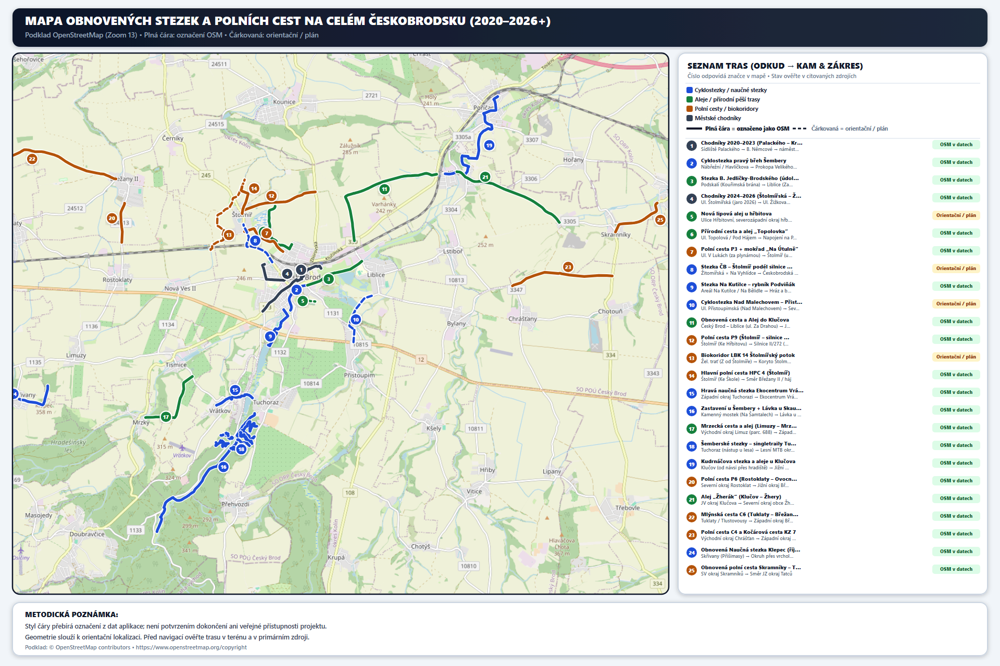
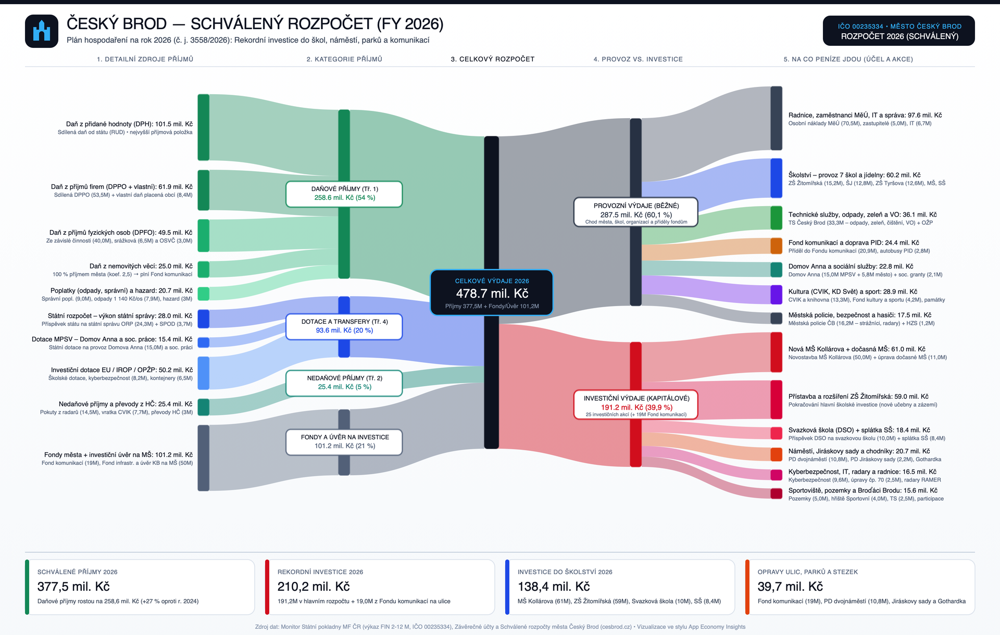
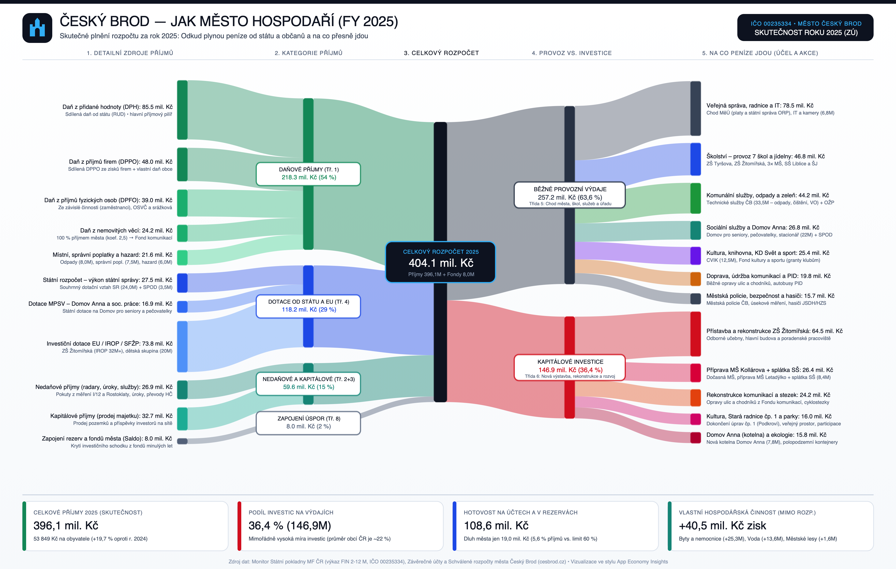
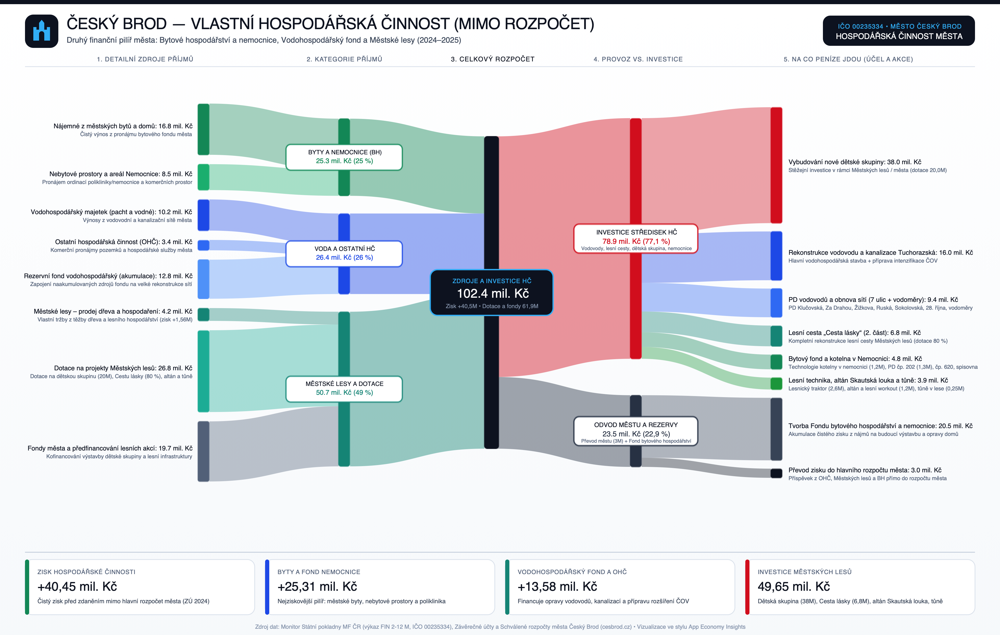

# Město Český Brod & Českobrodsko: Obnovené cesty v krajině a městské finance (2020–2026+)

Nezávislý datový přehled pro město Český Brod (IČO 00235334) a mikroregion Českobrodsko. Projekt na jednom místě propojuje zmapování fyzického rozvoje cestní sítě v terénu s detailní analýzou veřejných financí a hospodářské činnosti města.

**Webová aplikace:** [davidhunka.github.io/cesky-brod-atlas](https://davidhunka.github.io/cesky-brod-atlas/)

---

## Přehled výstupů v repozitáři

| Výstup | Obsah a rozsah dat | Soubor / odkaz |
| :--- | :--- | :--- |
| **Interaktivní webová aplikace** | Webová mapa 25 tras na podkladu OpenStreetMap (filtry podle období, přesnosti zákresu a kategorie, detailní karty s citacemi a odkazy na primární dokumenty) a interaktivní Sankey diagramy rozpočtu města (2023–2026) i vlastní hospodářské činnosti | [Otevřít aplikaci (GitHub Pages)](https://davidhunka.github.io/cesky-brod-atlas/) / [`index.html`](./index.html) |
| **Otevřená prostorová data (GeoJSON)** | Geometrie všech 25 tras v souřadnicovém systému WGS-84 (`EPSG:4326`) včetně atributů, citací, odkazů na veřejné zakázky, OpenStreetMap, Mapy.cz a Google Maps | [`trasy_ceskobrodsko.geojson`](./trasy_ceskobrodsko.geojson) |
| **Kartografická přehledová mapa** | Statická mapa celého regionu Českobrodska s barevným rozlišením tras podle období realizace | [`mapa_stezky_podle_roku.png`](./mapa_stezky_podle_roku.png) |
| **Sankey diagramy rozpočtu a VHČ** | Statické exporty finančních toků města ve vysokém rozlišení (skutečnost 2023–2025, schválený rozpočet 2026 a vlastní hospodářská činnost) | [`2026`](./rozpocet_sankey_2026.png) · [`2025`](./rozpocet_sankey_2025.png) · [`2024`](./rozpocet_sankey_2024.png) · [`2023`](./rozpocet_sankey_2023.png) · [`VHČ`](./rozpocet_sankey_vhc.png) |

---

## Část 01 — Mapování obnovených cest, alejí a stezek (2020–2026+)

Datová sada eviduje **25 polních cest z komplexních pozemkových úprav (KPÚ), nově vysazených alejí, příměstských stezek a souvislých oprav městských chodníků** realizovaných či připravovaných v letech 2020–2026+.



### Metodika zákresu a přesnost geometrie
- **Plná čára — Ověřeno v OpenStreetMap (13 tras):** Trasa vede po reálně zmapované cestní síti v databázi OpenStreetMap / Mapy.cz (hlavní polní cesta HPC 4, cesta P3 kolem mokřadu Na Útulně, Topolovka, asfaltová stezka P6 Rostoklaty – Břežany II, Stezka B. Jedličky-Brodského, polní cesta do Klučova, Kudrnáčova stezka, Šemberské singletraily, Zastavení u Šembery, Mrzecká cesta Limuzy – Mrzky, NS Klepec a městské chodníky).
- **Čárkovaná čára — Orientační / plán (12 tras):** Stavby v přípravě, projektové koridory nebo polní trasy a biokoridory, kde některý úsek v OpenStreetMap dosud není plně zakreslen (např. připravovaná cyklostezka Nad Malechovem – Přistoupim, páteřní stezka podél II/245 do Štolmíře, nábřežní cyklostezka Pod Malechovem či propojení areálu Na Kutilce přes I/12 k hrázi rybníka Podviňák).

### Souhrnný přehled 25 tras a ověřovacích pramenů

| ID | Název trasy | Úsek (Odkud → Kam) | Období | Zákres v OSM | Primární evidenční pramen (přímý odkaz na dokument) |
| :-: | :--- | :--- | :-: | :--- | :--- |
| **1** | Polní cesta P9 | Štolmíř (Ke Hřbitovu) → Ul. Kounická (II/272) | 2020–2021 | Orientační | [SPÚ & MZe – Veřejná zakázka „Výstavba polní cesty P 9 v k.ú. Štolmíř“ (PDF)](https://zakazky.eagri.cz/document_audit_12838/c03811b5be611464e043821411aca521-pdf) |
| **2** | Hlavní polní cesta HPC 4 | Štolmíř (Ke Škole) → směr Břežany II / háj | 2020–2021 | Ověřeno v OSM | [SPÚ Kolín – Realizované projekty PRV: KoPÚ Štolmíř (cesta HPC 4, 591 m)](https://spu.gov.cz/pozemkove-upravy/program-rozvoje-venkova/projekty/projekty-zrealizovane) |
| **3** | Polní cesta P3 + mokřad Na Útulně | Ul. V Lukách (za plynárnou) → Štolmíř (ul. K Lukám) | 2024 | Ověřeno v OSM | [Město Český Brod – Koncepční studie a úpravy lokality Na Útulně u cesty P3](https://www.ns.cesbrod.cz/item/verejne-setkani-na-utulne) |
| **4** | Přírodní cesta a alej Topolovka | Ul. Topolová / Pod Hájem → napojení na P9 (Štolmíř) | 2024 | Ověřeno v OSM | [Participativní rozpočet ČB – „Zútulnění pěších tras z Brodu na Štolmíř (Topolovka)“](https://www.participativni-rozpocet.cz/ceskybrod/navrhy/zutulneni-pesich-tras-z-brodu-na-stolmir/) |
| **5** | Biokoridor LBK 14 Štolmířský potok | Žel. trať (Z od Štolmíře) → koryto Štolmířského potoka | 2022–2023 | Orientační | [SPÚ Kolín – Projektový list „Výsadba biokoridoru LBK 14 v k.ú. Štolmíř“ (PDF)](https://spu.gov.cz/frontend/webroot/uploads/files/2018/01/vysadba_biokoridoru_lbk_14_v_k7383.u7383._stolmir7383.pdf) |
| **6** | Polní cesta P6 s biokoridorem | Severní okraj Rostoklat → jižní okraj Břežan II (900 m) | 2022–2023 | Ověřeno v OSM | [SPÚ Kolín – Projektový list KoPÚ v k.ú. Rostoklaty a Nová Ves II (PDF)](https://spu.gov.cz/frontend/webroot/uploads/files/2020/05/realizace_lokalnich_biocenter_bc_4_a_bc_6_v_k10370.u10370._nova_ves_ii10370._a_bc_2a_v_k10370.u10370._rostoklaty10370.pdf) |
| **7** | Mlýnská cesta C6 | Tuklaty / Tlustovousy → západní okraj Břežan II | 2022–2023 | Orientační | [SPÚ Kolín – Projektový list „Polní cesta C 6 v k.ú. Tuklaty a Břežany II“ (PDF)](https://spu.gov.cz/frontend/webroot/uploads/files/2018/01/polni_cesta_c_6_v_k7388.u7388._tuklaty7388.pdf) |
| **8** | Stezka B. Jedličky-Brodského | Podskalí (Kouřimská brána) → sv. Gothard → Liblice | 2024 | Ověřeno v OSM | [IC CVIK ČB – Detail trasy](https://ic.cvik.info/stezka-bretislava-jedlicky-brodskeho) · [Registr smluv č. 33545964 (V Podskalí)](https://smlouvy.gov.cz/smlouva/33545964) |
| **9** | Cyklostezka pravý břeh Šembery | Nábřežní / Havlíčkova → Prokopa Velikého (Pod Malechovem) | 2026 | Orientační | [Usnesení Města ČB příloha 7381 (p.č. 118/1 a 118/7)](https://usneseni.cesbrod.cz/usneseni/usneseni/priloha/7381) · [Situace DSP (PDF)](https://lotus.cesbrod.cz/MUCB%5Carz.nsf/0/E69C91EF472CB0EEC125878F00318694/%24file/z199_SITUACE_DSP_PRACOVNI_211117_PREDAVANE.pdf) |
| **10** | Nová lipová alej u hřbitova | Městský hřbitov (ul. Hřbitovní) → východní roh hřbitova (235 m) | 2026 | Orientační | [Sázíme stromy č. 1622 (1. etapa)](https://sazimestromy.cz/sazeni/1622) · [akce č. 1715 (2. etapa u hřbitova)](https://sazimestromy.cz/sazeni/1715) |
| **11** | Obnovená cesta a Alej do Klučova | Český Brod – Liblice (ul. Za Drahou) → JZ okraj Klučova | 2022–2023 | Ověřeno v OSM | [Českobrodský zpravodaj – veřejná zakázka „Alej Klučov – Český Brod“ (PDF)](https://cesbrod.cz/files/ceskybrod/gallery/12171/66ac980452048_CeskobrodskyZpravodaj-2020-rijen.pdf) |
| **12** | Kudrnáčova stezka a aleje | Klučov (od návsi přes hradiště) → jižní okraj Poříčan | 2022–2023 | Ověřeno v OSM | [Naučné-stezky.cz – Kudrnáčova stezka](https://www.naucne-stezky.cz/kudrnacova-stezka/) · [Sázíme stromy č. 1314](https://sazimestromy.cz/sazeni/1314) |
| **13** | Alej „Žherák“ | JV okraj Klučova → severní okraj obce Žhery | 2024 | Orientační | [Sázíme stromy č. 950 – „Z Klučova na Žhery krásným stromořadím“](https://sazimestromy.cz/sazeni/950) |
| **14** | Polní cesta Skramníky – Tatce | SV okraj Skramníků → směr JZ okraj Tatců | 2024 | Orientační | [Sázíme stromy č. 1143 – Obnova a výsadba na polní cestě Skramníky – Tatce](https://sazimestromy.cz/sazeni/1143) |
| **15** | Cesta C4 a Kočárová cesta KZ 7 | Východní okraj Chrášťan → západní okraj Chotouně | 2025 | Orientační | [SPÚ Kolín – Projektový list „Polní cesta C4 a KZ7 v k.ú. Chrášťany u ČB“ (PDF)](https://spu.gov.cz/frontend/webroot/uploads/files/2025/01/polni_cesta_c4_v_k24503.u24503._chrastany_u_cb_s_doprovodnou_zeleni_a_vysadbou_zelene_v_doprovodnem_prvku_kz7_224503.pdf) |
| **16** | Cyklostezka Nad Malechovem – Přistoupim | Ul. Přistoupimská (Nad Malechovem) → Přistoupim (III/1131) | Plán 2026+ | Plán / příprava | [Vyjádření místostarosty T. Klineckého – Cyklostezka ČB – Přistoupim (600 m)](https://www.top09.cz/regiony/stredocesky-kraj/top-09-v-mediich/klinecky-nova-cyklostezka-spoji-cesky-brod-se-sousedni-obci-30834.html) |
| **17** | Stezka ČB – Štolmíř podél II/245 | Žitomířská × Na Vyhlídce → Českobrodská × Lichtenštejnská | Plán 2026+ | Plán / příprava | [Generel cyklodopravy města Český Brod – páteřní stezka podél II/245 (PDF)](https://cesbrod.cz/files/ceskybrod/gallery/12024/668e6669c9eac_Generel-cyklodopravy-text.pdf) |
| **18** | Stezka Na Kutilce – rybník Podviňák | Areál Na Kutilce / Na Bělidle → hráz rybníka Podviňák | 2024 | Orientační (přechod I/12) | [Zastupitelstvo ČB (Tisk 44): „Zpracování urbanistické studie areálu Kutilka“ (PDF)](https://lotus.cesbrod.cz/__C1257E4D002B7D3A.nsf/0/61248EEEB1D71D30C125855F0049BC1E/%24File/Tisk_44_Jakub%20Nekoln%C3%BD_Zpracov%C3%A1n%C3%AD%20urbanistick%C3%A9%20studie%20are%C3%A1lu%20Kutilka.pdf?OpenElement) |
| **19** | Šemberské stezky – singletraily | Tuchoraz (nástup u lesa) → lesní MTB okruh (5 km) | 2020–2021 | Ověřeno v OSM | [Spolek Šemberské stezky z.s. – Oficiální mapa a dokumentace singletrailů](https://www.semberskestezky.cz/) |
| **20** | Zastavení u Šembery + Lávka u Skautské louky | Kamenný mostek (Na Šamtalech) → Skautská louka → Na Zámkách | 2024 | Ověřeno v OSM | [Město ČB – „Zastavení u Šembery a lávka“](https://cesbrod.cz/default/default/24199_nadace-cez) · [E-ZAK VZ00000164 (Altán)](https://ezak.cesbrod.cz/vz00000164) |
| **21** | Hravá NS Ekocentrum Vrátkov | Západní okraj Tuchorazi → hájovna Ekocentrum Vrátkov čp. 38 | 2022–2023 | Orientační | [Město ČB – Projekt Ekocentrum Vrátkov](https://cesbrod.cz/default/default/18045_ekocentrum-vratkov) · [ekocentrumvratkov.cz](https://www.ekocentrumvratkov.cz/) |
| **22** | Mrzecká cesta a alej | Východní okraj Limuz (parc. 688) → západní okraj obce Mrzky | 2026 | Ověřeno v OSM | [Obec Tismice – Obnova aleje na Mrzecké cestě (parc. 688 k.ú. Limuzy)](https://www.tismice.cz/obec/aktuality/do-jasanove-aleje-na-mrzecke-ceste-vstup-jen-na-vlastni-nebezpeci-443cs.html) |
| **23** | Obnovená Naučná stezka Klepec | Skřivany (Přišimasy) → okruh přes vrchol Klepec (358 m) zpět do Skřivan | 2026 | Ověřeno v OSM | [Obec Přišimasy – „Klepec má novou naučnou stezku“ (kompletní obnova)](https://www.prisimasy.cz/zivot-v-obci/aktuality/klepec-ma-novou-naucnou-stezku-1623cs.html) |
| **24** | Chodníky 2024–2026 | Ul. Štolmířská, Sportovní, Žižkova, Želivského, Tuchorazská | 2026 | Ověřeno v OSM | [E-ZAK ČB dok. č. 3425 (Štolmířská)](https://ezak.cesbrod.cz/document_download_3425.html) · [zakázka č. 222 (Sportovní)](https://ezak.cesbrod.cz/contract_display_222.html) |
| **25** | Chodníky 2020–2023 | Sídliště Palackého → Zborovská → Jana Kouly → Krále Jiřího | 2020–2021 | Ověřeno v OSM | [E-ZAK ČB zakázka č. 225 – Chodníky Zborovská, Jana Kouly a Krále Jiřího](https://ezak.cesbrod.cz/contract_display_225.html) |

---

## Část 02 — Veřejné finance a hospodářská činnost města (2023–2026)

Druhá část projektu zpracovává rozpočtová data města Český Brod z portálu **Monitor MF ČR**, závěrečných účtů města (2023–2025) a schváleného rozpočtu na rok 2026 (`č. j. 3558/2026`). Kromě hlavního rozpočtu samostatně vyčleňuje i **Vlastní hospodářskou činnost města (VHČ)** — tedy hospodaření s městskými byty, areálem nemocnice/polikliniky, vodohospodářským majetkem a městskými lesy, které město účtuje mimo hlavní rozpočet — a umožňuje zobrazit oba světy spojené do jednoho konsolidovaného celku.

### Souhrnná bilance rozpočtů a hospodářské činnosti

| Období / pohled | Celkové příjmy / zdroje | Celkové výdaje | Běžný provoz (OPEX) | Kapitálové investice (CAPEX) | Klíčové investiční akce daného období |
| :--- | ---: | ---: | ---: | ---: | :--- |
| **2023 — Skutečnost (ZÚ)** | 302,6 mil. Kč | **315,0 mil. Kč** | 246,0 mil. Kč (78,1 %) | 69,0 mil. Kč (21,9 %) | Rekonstrukce Staré radnice čp. 1 (Podkroví), příprava ZŠ Žitomířská, zateplení čp. 56 |
| **2024 — Skutečnost (ZÚ)** | 331,0 mil. Kč | **330,5 mil. Kč** | 228,5 mil. Kč (69,1 %) | 102,0 mil. Kč (30,9 %) | Zahájení přístavby ZŠ Žitomířská, polopodzemní kontejnery, digitalizace úřadu, chodníky |
| **2025 — Skutečnost (ZÚ)** | 396,1 mil. Kč | **404,1 mil. Kč** | 257,2 mil. Kč (63,6 %) | 146,9 mil. Kč (36,4 %) | Přístavba ZŠ Žitomířská (64,5M), příprava MŠ Kollárova (26,4M), Fond komunikací (24,2M) |
| **2026 — Schválený rozpočet** | 377,5 mil. Kč (+ 101,2M fondy a úvěr) | **478,7 mil. Kč** | 287,5 mil. Kč (60,1 %) | 191,2 mil. Kč (39,9 %) | Novostavba MŠ Kollárova (61,0M), dokončení ZŠ Žitomířská (59,0M), PD dvojnáměstí (10,8M) |
| **Vlastní hosp. činnost (VHČ)** | Roční výnosy 81,5M (čistý zisk **+40,5M**) | **102,4 mil. Kč** (alokace zisku, fondů a dotací) | 23,5 mil. Kč (odvod městu a tvorba Fondu BH) | 78,9 mil. Kč (investice středisek 2025/26) | Dětská skupina (38,0M), vodovod a kanalizace Tuchorazská (16,0M), PD vodovodů 7 ulic (9,4M), Cesta lásky (6,8M) |
| **2026 — Konsolidovaný celek** | **578,1 mil. Kč** (očištěno o 3M interní převod) | **578,1 mil. Kč** | 308,0 mil. Kč (53,3 %) | **270,1 mil. Kč (46,7 %)** | Spojená bilance hlavního rozpočtu (191,2M investic) a investičních akcí středisek VHČ (78,9M) |

### Schválený rozpočet města na rok 2026 (478,7 mil. Kč)


### Skutečnost roku 2025 (404,1 mil. Kč)


### Vlastní hospodářská činnost města (byty, nemocnice, voda, lesy)


---

## Technická dokumentace a lokální spuštění

Webová aplikace v souboru [`index.html`](./index.html) je navržena jako samostatný statický výstup bez závislosti na externím backendu (využívá Leaflet + OpenStreetMap a nativní SVG generátor Sankey diagramů).

```bash
# Otevření lokálně v prohlížeči nebo přes lokální HTTP server
python -m http.server 8000

# Přegenerování statických map a datových exportů
python generate_maps.py
```

### Datové zdroje
- **Cesty a pozemkové úpravy:** Státní pozemkový úřad (Pobočka Kolín), Profil zadavatele města Český Brod (`ezak.cesbrod.cz`), Registr smluv ČR (`smlouvy.gov.cz`), Usnesení Rady a Zastupitelstva města Český Brod (`usneseni.cesbrod.cz`), Generel cyklodopravy města Český Brod, Sázíme stromy z.ú., Spolek NeKluč!, OpenStreetMap.
- **Veřejné finance:** Informační portál Ministerstva financí ČR Monitor (`monitor.statnipokladna.cz`, IČO `00235334`), Závěrečné účty města Český Brod za roky 2023, 2024 a 2025, Schválený rozpočet města Český Brod na rok 2026 (`č. j. 3558/2026`).
