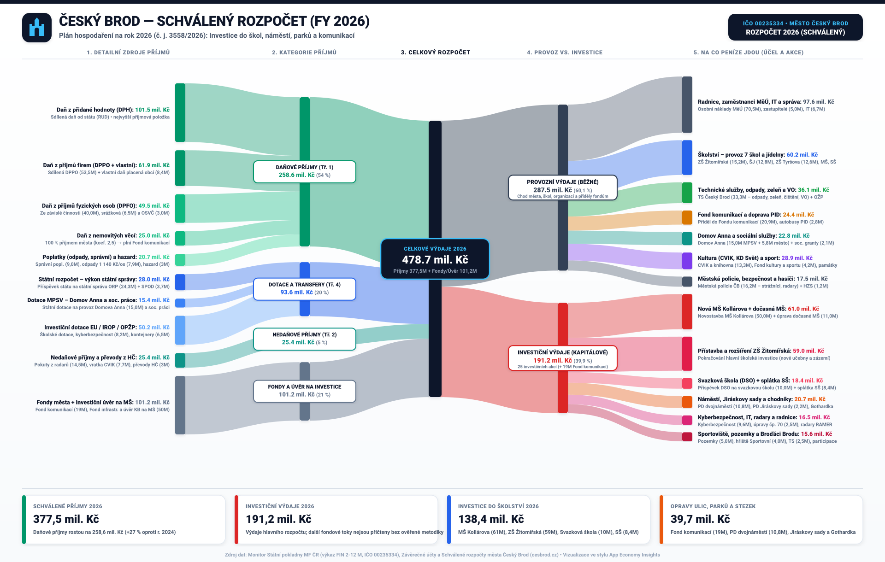
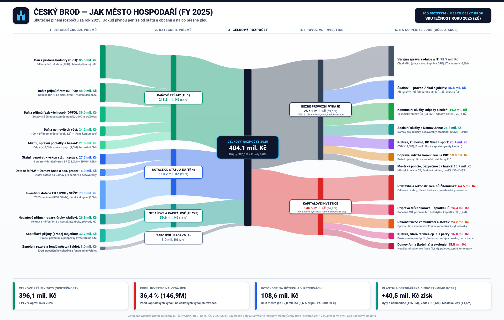
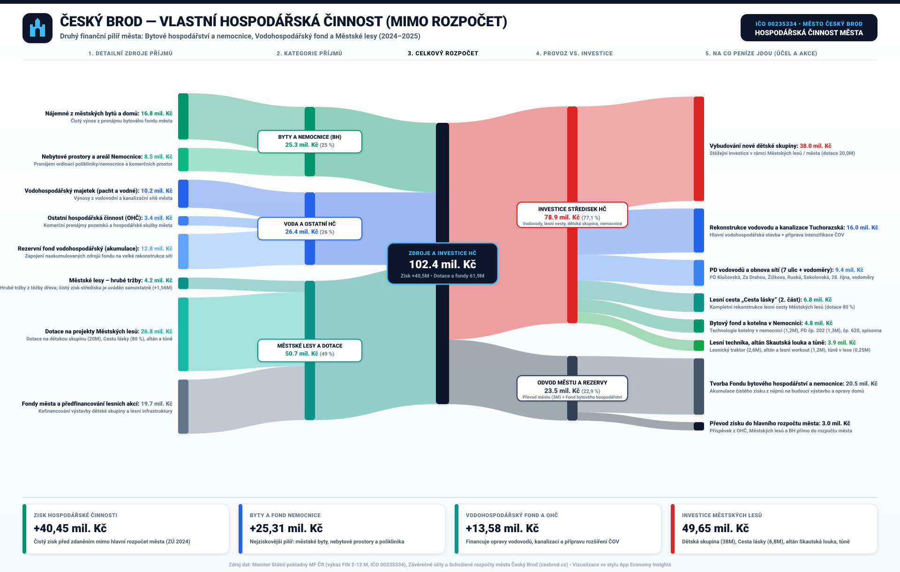

# Finance města Český Brod

## Část 02 — Veřejné finance a hospodářská činnost města (2023–2026)

Druhá část projektu zpracovává rozpočtová data města Český Brod z portálu **Monitor MF ČR**, závěrečných účtů města (2023–2025) a schváleného rozpočtu na rok 2026 (`č. j. 3558/2026`). Vlastní hospodářská činnost města (VHČ) je uvedena samostatně: město ji účtuje mimo běžný rozpočet a převádí mezi těmito dvěma oblastmi peníze. Prostý součet by proto mohl stejný převod započítat jako výdaj VHČ i jako příjem rozpočtu. Dostupné uzavřené výsledky a investiční akce navíc pokrývají různá období; konsolidovaný součet neuvádíme, dokud nebudou ověřeny časové přiřazení a metodika interních převodů.

### Souhrnná bilance rozpočtů a hospodářské činnosti

| Období / pohled | Celkové příjmy / zdroje | Celkové výdaje | Běžný provoz (OPEX) | Kapitálové investice (CAPEX) | Klíčové investiční akce daného období |
| :--- | ---: | ---: | ---: | ---: | :--- |
| **2023 — Skutečnost (ZÚ)** | 302,6 mil. Kč | **315,0 mil. Kč** | 246,0 mil. Kč (78,1 %) | 69,0 mil. Kč (21,9 %) | Rekonstrukce Staré radnice čp. 1 (Podkroví), příprava ZŠ Žitomířská, zateplení čp. 56 |
| **2024 — Skutečnost (ZÚ)** | 331,0 mil. Kč | **330,5 mil. Kč** | 228,5 mil. Kč (69,1 %) | 102,0 mil. Kč (30,9 %) | Zahájení přístavby ZŠ Žitomířská, polopodzemní kontejnery, digitalizace úřadu, chodníky |
| **2025 — Skutečnost (ZÚ)** | 396,1 mil. Kč | **404,1 mil. Kč** | 257,2 mil. Kč (63,6 %) | 146,9 mil. Kč (36,4 %) | Přístavba ZŠ Žitomířská (64,5M), příprava MŠ Kollárova (26,4M), Fond komunikací (24,2M) |
| **2026 — Schválený rozpočet** | 377,5 mil. Kč (+ 101,2M fondy a úvěr) | **478,7 mil. Kč** | 287,5 mil. Kč (60,1 %) | 191,2 mil. Kč (39,9 %) | Novostavba MŠ Kollárova (61,0M), dokončení ZŠ Žitomířská (59,0M), PD dvojnáměstí (10,8M) |

### VHČ: oddělený uzavřený výsledek a investiční akce

- **Uzavřený výsledek 2024:** výnosy 81,46 mil. Kč, náklady 41,01 mil. Kč a zisk před zdaněním 40,45 mil. Kč. Rozpad zisku ve zdrojových podkladech: byty a nemocnice 25,31 mil. Kč, voda a ostatní hospodářská činnost 13,58 mil. Kč, městské lesy 1,56 mil. Kč.
- **Investiční akce 2025–2026:** vybrané akce v celkové hodnotě 78,9 mil. Kč. Dostupné podklady nerozepisují částky podle roku čerpání, proto z nich nelze určit samostatný objem investic za rok 2026.

Závěrečný účet VHČ za rok 2025 se nepodařilo dohledat v [seznamu závěrečných účtů města](https://cesbrod.cz/default/default/14762_zaverecne-ucty). Výsledek za rok 2024 proto není označen jako „loňský“.

### Ovládání v atlasu

Rozpočet města i hospodářská činnost mají společné uspořádání: výběr období, souhrnné ukazatele a graf. Roky rozpočtu 2026–2023 jsou přímo dostupné jako tlačítka. Přepnutí hospodářské činnosti mění nadpis, ukazatele i graf: uzavřený rok 2024 ukazuje výnosy, náklady a zisk; investice 2025–2026 původní společný Sankey diagram s upozorněním na kombinaci období. Pod ním je trvale zobrazený rozpis investičních akcí, bez rozklikávání. Částky akcí nejsou rozdělené podle ročního čerpání.

### Schválený rozpočet města na rok 2026 (478,7 mil. Kč)

### Skutečnost roku 2025 (404,1 mil. Kč)

### Archivní ilustrace VHČ (kombinuje více období)

Tento archivní diagram kombinuje výsledek za rok 2024 s investičními akcemi z období 2025–2026; není to roční uzávěrka ani přehled investic jednoho roku. V aplikaci jsou proto výsledek a investiční akce dostupné jako samostatné pohledy.

---
