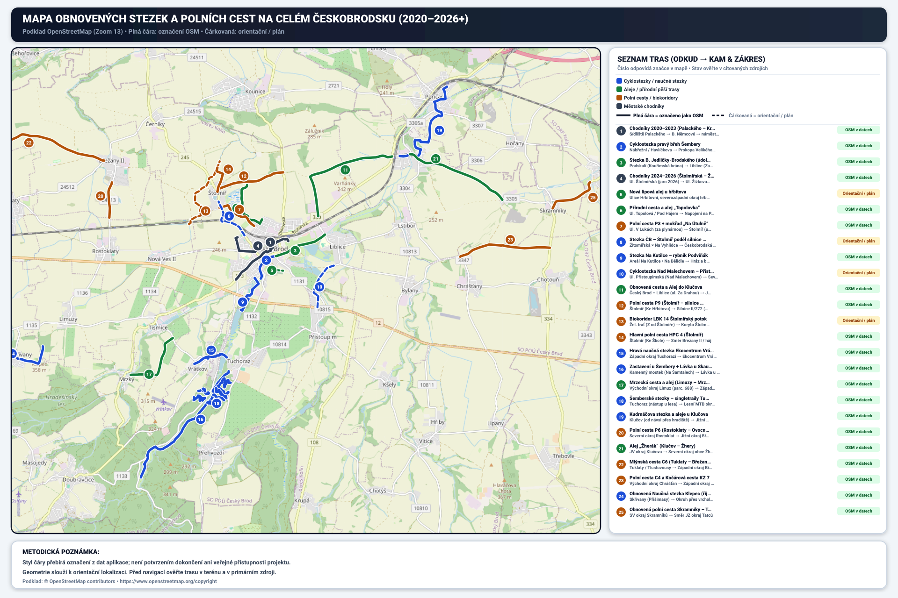

# Přehled tras a mapová data

## Část 01 — Mapování obnovených cest, alejí a stezek (2020–2026+)

Datová sada obsahuje **25 vybraných záznamů** k cestám, alejím, stezkám a chodníkům na Českobrodsku. Jde o orientační přehled, nikoli úplný registr realizovaných staveb.

### Barevný systém a typologie tras v mapě
Barevnost tras v mapě odpovídá jejich **fyzickému typu a charakteru v terénu**, namísto náhodného přebarvování podle roku realizace:
- **Safírová modrá (`#1d4ed8`):** Cyklostezky a turistické naučné stezky (9 tras)
- **Lesní zelená (`#15803d`):** Obnovené aleje a přírodní pěší stezky v zeleni (6 tras)
- **Zemitá okrová (`#b45309`):** Zpevněné a polní cesty z pozemkových úprav KPÚ (8 tras)
- **Grafitová břidlice (`#334155`):** Zrekonstruované městské chodníky a bezbariérové přechody (2 trasy)

### Metodika zákresu a přesnost geometrie
- **Plná čára (22 záznamů):** V datech aplikace označeno jako geometrie OSM. Označení samo o sobě nepotvrzuje realizaci projektu, přístupnost ani to, že linie odpovídá celé stavbě.
- **Čárkovaná čára (3 záznamy):** V datech aplikace označeno jako orientační, plán nebo koridor. Tato kategorie spojuje různé stavy; konkrétní informace ověřujte v kartě a citovaných zdrojích.
- Vykreslené linie mohou být odvozené z pěšího routingu mezi ručně zvolenými body. Nejsou ověřeným geodetickým zaměřením ani doporučením pro navigaci.

### Souhrnný přehled 25 tras (seřazeno a očíslováno #1–#25 podle vzdálenosti od centra Českého Brodu)

| ID | Název trasy | Úsek (Odkud → Kam) | Období dle evidence | Náklady / investice (rozsah viz detail) | Označení zákresu v aplikaci | Evidenční pramen (odkaz; jeho povaha se liší) |
| :-: | :--- | :--- | :-: | :--- | :--- | :--- |
| **1** | Chodníky 2020–2023 | Sídliště Palackého → Zborovská → Jana Kouly → Krále Jiřího | 2020–2021? (název uvádí 2020–2023) | **~6,8 mil. Kč** | Označeno OSM | [E-ZAK ČB zakázka č. 225 – Chodníky Zborovská, Jana Kouly a Krále Jiřího](https://ezak.cesbrod.cz/contract_display_225.html) |
| **2** | Cyklostezka pravý břeh Šembery | Nábřežní / Havlíčkova → Prokopa Velikého (Pod Malechovem) | 2026 | **6,31 mil. Kč** | Označeno OSM; realizaci ověřte | [Usnesení Města ČB příloha 7381 (p.č. 118/1 a 118/7)](https://usneseni.cesbrod.cz/usneseni/usneseni/priloha/7381) · [Situace DSP (PDF)](https://lotus.cesbrod.cz/MUCB%5Carz.nsf/0/E69C91EF472CB0EEC125878F00318694/%24file/z199_SITUACE_DSP_PRACOVNI_211117_PREDAVANE.pdf) |
| **3** | Stezka B. Jedličky-Brodského | Podskalí (Kouřimská brána) → sv. Gothard → Liblice | 2024 | **~380 tis. Kč** | Označeno OSM | [IC CVIK ČB – Detail trasy](https://ic.cvik.info/stezka-bretislava-jedlicky-brodskeho) · [Registr smluv č. 33545964 (V Podskalí)](https://smlouvy.gov.cz/smlouva/33545964) |
| **4** | Chodníky 2024–2026 | Ul. Štolmířská, Sportovní, Žižkova, Želivského, Tuchorazská | 2026 | **4,2M chodníky (19,3M se sítěmi)** | Označeno OSM | [E-ZAK ČB dok. č. 3425 (Štolmířská)](https://ezak.cesbrod.cz/document_download_3425.html) · [zakázka č. 222 (Sportovní)](https://ezak.cesbrod.cz/contract_display_222.html) |
| **5** | Nová lipová alej u hřbitova | Městský hřbitov (ul. Hřbitovní) → východní roh hřbitova (235 m) | 2026 | **~180 tis. Kč** | Částečně v OSM (dle evidence) | [Sázíme stromy č. 1622 (1. etapa)](https://sazimestromy.cz/sazeni/1622) · [akce č. 1715 (2. etapa u hřbitova)](https://sazimestromy.cz/sazeni/1715) |
| **6** | Přírodní cesta a alej Topolovka | Ul. Topolová / Pod Hájem → napojení na P9 (Štolmíř) | 2024 | **~250 tis. Kč** | Částečně v OSM (dle evidence) | [Participativní rozpočet ČB – „Zútulnění pěších tras z Brodu na Štolmíř (Topolovka)“](https://www.participativni-rozpocet.cz/ceskybrod/navrhy/zutulneni-pesich-tras-z-brodu-na-stolmir/) |
| **7** | Polní cesta P3 + mokřad Na Útulně | Ul. V Lukách (za plynárnou) → Štolmíř (ul. K Lukám) | 2024 | **3,4M cesta + 253 tis. Kč prvky** | Označeno OSM | [Město Český Brod – Koncepční studie a úpravy lokality Na Útulně u cesty P3](https://www.ns.cesbrod.cz/item/verejne-setkani-na-utulne) |
| **8** | Stezka ČB – Štolmíř podél II/245 | Žitomířská × Na Vyhlídce → Českobrodská × Lichtenštejnská | Plán 2026+ | **Odhad 12–15 mil. Kč (plán)** | Orientační / plán | [Generel cyklodopravy města Český Brod – páteřní stezka podél II/245 (PDF)](https://cesbrod.cz/files/ceskybrod/gallery/12024/668e6669c9eac_Generel-cyklodopravy-text.pdf) |
| **9** | Stezka Na Kutilce – rybník Podviňák | Areál Na Kutilce / Na Bělidle → hráz rybníka Podviňák | 2024 / etapa 2026 | **350 tis. Kč (etapa 2026)** | Označeno OSM; realizaci ověřte | [Zastupitelstvo ČB (Tisk 44): „Zpracování urbanistické studie areálu Kutilka“ (PDF)](https://lotus.cesbrod.cz/__C1257E4D002B7D3A.nsf/0/61248EEEB1D71D30C125855F0049BC1E/%24File/Tisk_44_Jakub%20Nekoln%C3%BD_Zpracov%C3%A1n%C3%AD%20urbanistick%C3%A9%20studie%20are%C3%A1lu%20Kutilka.pdf?OpenElement) |
| **10** | Cyklostezka Nad Malechovem – Přistoupim | Ul. Přistoupimská (Nad Malechovem) → Přistoupim (III/1131) | Plán 2026+ | **Odhad 6–9 mil. Kč (plán)** | Orientační / plán | [Vyjádření místostarosty T. Klineckého – Cyklostezka ČB – Přistoupim (600 m)](https://www.top09.cz/regiony/stredocesky-kraj/top-09-v-mediich/klinecky-nova-cyklostezka-spoji-cesky-brod-se-sousedni-obci-30834.html) |
| **11** | Obnovená cesta a Alej do Klučova | Český Brod – Liblice (ul. Za Drahou) → JZ okraj Klučova | 2022–2023 | **450 000 Kč (dotace)** | Částečně v OSM (dle evidence) | [Českobrodský zpravodaj – veřejná zakázka „Alej Klučov – Český Brod“ (PDF)](https://cesbrod.cz/files/ceskybrod/gallery/12171/66ac980452048_CeskobrodskyZpravodaj-2020-rijen.pdf) |
| **12** | Polní cesta P9 | Štolmíř (Ke Hřbitovu) → Silnice II/272 (směr Kounice) | 2020–2021 | **~5,8 mil. Kč (cesta P9)** | Označeno OSM | [SPÚ & MZe – Veřejná zakázka „Výstavba polní cesty P 9 v k.ú. Štolmíř“ (PDF)](https://zakazky.eagri.cz/document_audit_12838/c03811b5be611464e043821411aca521-pdf) |
| **13** | Biokoridor LBK 14 Štolmířský potok | Žel. trať (Z od Štolmíře) → koryto Štolmířského potoka | 2022–2023 | **1,20 mil. Kč s DPH** | Orientační zákres; stav zvlášť | [SPÚ Kolín – Projektový list „Výsadba biokoridoru LBK 14 v k.ú. Štolmíř“ (PDF)](https://spu.gov.cz/frontend/webroot/uploads/files/2018/01/vysadba_biokoridoru_lbk_14_v_k7383.u7383._stolmir7383.pdf) |
| **14** | Hlavní polní cesta HPC 4 | Štolmíř (Ke Škole) → směr Břežany II / háj | 2020–2021 | **~4,1 mil. Kč s DPH** | Označeno OSM | [SPÚ Kolín – Realizované projekty PRV: KoPÚ Štolmíř (cesta HPC 4, 591 m)](https://spu.gov.cz/pozemkove-upravy/program-rozvoje-venkova/projekty/projekty-zrealizovane) |
| **15** | Hravá NS Ekocentrum Vrátkov | Západní okraj Tuchorazi → hájovna Ekocentrum Vrátkov čp. 38 | 2022–2023 | **~350 tis. Kč (jen stezka)** | Částečně v OSM (dle evidence) | [Město ČB – Projekt Ekocentrum Vrátkov](https://cesbrod.cz/default/default/18045_ekocentrum-vratkov) · [ekocentrumvratkov.cz](https://www.ekocentrumvratkov.cz/) |
| **16** | Zastavení u Šembery + Lávka u Skautské louky | Kamenný mostek (Na Šamtalech) → Skautská louka → Na Zámkách | 2024 | **300 tis. Kč + 1,2M altán** | Označeno OSM | [Město ČB – „Zastavení u Šembery a lávka“](https://cesbrod.cz/default/default/24199_nadace-cez) · [E-ZAK VZ00000164 (Altán)](https://ezak.cesbrod.cz/vz00000164) |
| **17** | Mrzecká cesta a alej | Východní okraj Limuz (parc. 688) → západní okraj obce Mrzky | 2026 | **~150 tis. Kč** | Označeno OSM | [Obec Tismice – Obnova aleje na Mrzecké cestě (parc. 688 k.ú. Limuzy)](https://www.tismice.cz/obec/aktuality/do-jasanove-aleje-na-mrzecke-ceste-vstup-jen-na-vlastni-nebezpeci-443cs.html) |
| **18** | Šemberské stezky – singletraily | Tuchoraz (nástup u lesa) → lesní MTB okruh (5 km) | 2020–2021 | **Komunitně (~200 tis. Kč)** | Označeno OSM | [Spolek Šemberské stezky z.s. – Oficiální mapa a dokumentace singletrailů](https://www.semberskestezky.cz/) |
| **19** | Kudrnáčova stezka a aleje | Klučov (od návsi přes hradiště) → jižní okraj Poříčan | 2022–2023 | **60 tis. + ~120 tis. Kč** | Označeno OSM | [Naučné-stezky.cz – Kudrnáčova stezka](https://www.naucne-stezky.cz/kudrnacova-stezka/) · [Sázíme stromy č. 1314](https://sazimestromy.cz/sazeni/1314) |
| **20** | Polní cesta P6 s biokoridorem | Severní okraj Rostoklat → jižní okraj Břežan II (900 m) | 2022–2023 | **~4,5M cesta (5,35M biocentra)** | Označeno OSM | [SPÚ Kolín – Projektový list KoPÚ v k.ú. Rostoklaty a Nová Ves II (PDF)](https://spu.gov.cz/frontend/webroot/uploads/files/2020/05/realizace_lokalnich_biocenter_bc_4_a_bc_6_v_k10370.u10370._nova_ves_ii10370._a_bc_2a_v_k10370.u10370._rostoklaty10370.pdf) |
| **21** | Alej „Žherák“ | JV okraj Klučova → severní okraj obce Žhery | 2024 | **~95 tis. Kč** | Označeno OSM | [Sázíme stromy č. 950 – „Z Klučova na Žhery krásným stromořadím“](https://sazimestromy.cz/sazeni/950) |
| **22** | Mlýnská cesta C6 | Tuklaty / Tlustovousy → západní okraj Břežan II | 2022–2023 | **9,05 mil. Kč s DPH** | Označeno OSM | [SPÚ Kolín – Projektový list „Polní cesta C 6 v k.ú. Tuklaty a Břežany II“ (PDF)](https://spu.gov.cz/frontend/webroot/uploads/files/2018/01/polni_cesta_c_6_v_k7388.u7388._tuklaty7388.pdf) |
| **23** | Cesta C4 a Kočárová cesta KZ 7 | Východní okraj Chrášťan → západní okraj Chotouně | 2025 | **11,55 mil. Kč s DPH** | Částečně v OSM (dle evidence) | [SPÚ Kolín – Projektový list „Polní cesta C4 a KZ7 v k.ú. Chrášťany u ČB“ (PDF)](https://spu.gov.cz/frontend/webroot/uploads/files/2025/01/polni_cesta_c4_v_k24503.u24503._chrastany_u_cb_s_doprovodnou_zeleni_a_vysadbou_zelene_v_doprovodnem_prvku_kz7_224503.pdf) |
| **24** | Obnovená Naučná stezka Klepec | Skřivany (Přišimasy) → okruh přes vrchol Klepec (358 m) zpět do Skřivan | 2026? (ověřit) | **~480 tis. Kč** | Částečně v OSM (dle evidence) | [Obec Přišimasy – „Klepec má novou naučnou stezku“ (kompletní obnova)](https://www.prisimasy.cz/zivot-v-obci/aktuality/klepec-ma-novou-naucnou-stezku-1623cs.html) |
| **25** | Polní cesta Skramníky – Tatce | SV okraj Skramníků → směr JZ okraj Tatců | 2024 | **~85 tis. Kč** | Částečně v OSM (dle evidence) | [Sázíme stromy č. 1143 – Obnova a výsadba na polní cestě Skramníky – Tatce](https://sazimestromy.cz/sazeni/1143) |

---
